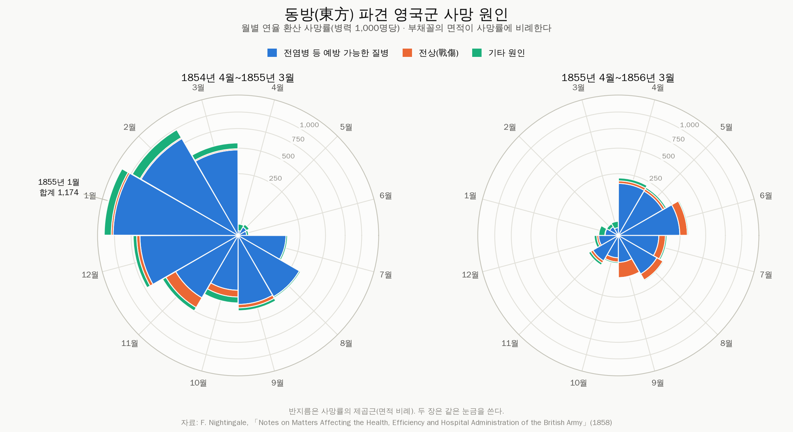

# art

연습용 프로젝트1

## 나이팅게일 장미 그래프 (Nightingale rose / polar area diagram)

Florence Nightingale 이 1858년에 그린 **"Diagram of the Causes of Mortality in
the Army in the East"** 를 다시 만든다. 1854년 4월부터 1856년 3월까지 24개월간
크림 전쟁에 파견된 영국군의 사망 원인을, 한 달에 한 조각씩 원을 채우는
부채꼴로 보여주는 그림이다.



그림이 말하는 것은 하나다. **전사자보다 예방 가능한 질병으로 죽은 사람이 훨씬
많았고**(파란 부채꼴), 1855년 3월 위생위원회가 도착한 뒤 그 파란 면적이
급격히 줄었다. 두 장은 같은 눈금을 쓰기 때문에 그 감소가 눈에 보인다.

### 이 문제의 핵심: 값은 반지름이 아니라 면적이다

중심각이 `θ` 인 부채꼴의 면적은 `θ/2 · r²` 이다. 그래서 값을 반지름에 그대로
넣으면 면적이 값의 **제곱**으로 커지고, 보는 사람은 실제보다 훨씬 부풀려진
크기를 읽는다. 장미 그래프를 잘못 그리는 거의 모든 경우가 여기서 갈린다.

```
r        = sqrt(value)                    # 부채꼴 하나
r_outer  = sqrt(r_inner² + value)         # 쌓아 올릴 때
```

`tests/test_rose.py::test_area_is_proportional_to_value` 가 모든 부채꼴에 대해
`면적 / 값` 이 일정한지 확인한다. 이 그래프에서 검증할 값이 하나뿐이라면 그것이다.

### 쓰는 법

```bash
pip install -r requirements.txt

python -m nightingale                                   # out/nightingale-rose.png
python -m nightingale --theme dark --out docs/rose-dark.png
python -m nightingale --layout superimposed             # 원본 작도 방식
python -m nightingale --table --no-chart                # 같은 값을 표로
python -m nightingale --table --no-chart --deaths       # 사망률 대신 사망자 수
python -m nightingale --lang en                         # 영문 라벨
```

파이썬에서:

```python
from nightingale import build_roses, format_table, save

save(build_roses(), "rose.png", theme="dark")
print(format_table())
```

```
연·월      병력     질병   전상   기타     합계
-------  ------  -------  -----  -----  -------
1854-04   8,571      1.4    0.0    7.0      8.4
...
1855-01  32,393  1,022.8   30.7  120.0  1,173.6
...
1856-03  46,140      3.9    0.0    9.1     13.0
```

### 두 가지 작도 방식

| | |
|---|---|
| **쌓아 그리기** (`stacked`, 기본값) | 세 원인을 중심에서 바깥으로 쌓는다. 한 달 전체 면적이 그 달의 총 사망률과 같다. |
| **겹쳐 그리기** (`superimposed`) | 원본의 작도법. 세 원인을 각각 중심에서부터 그려 서로 포갠다. |

원본 방식은 원인별 면적이 겹쳐 있어서, 작은 원인의 "보이는 면적"이 그 값과
일치하지 않는다. 오래 지적돼 온 약점이라 기본값은 `stacked` 로 두었다.
`docs/rose-superimposed.png` 에서 두 방식의 차이를 볼 수 있다.

### 구조

```
nightingale/
  data.py     원자료(사망자 수·병력)와 사망률 계산. 표준 라이브러리만 씀
  rose.py     부채꼴 기하 계산 — 그리지 않고 좌표만 만든다. 표준 라이브러리만 씀
  theme.py    검증된 색 팔레트(라이트/다크)와 한글 글꼴 탐색
  table.py    같은 값을 표로 출력
  render.py   matplotlib 렌더링
  cli.py      명령줄 진입점
tests/        40개 테스트 — 기하·데이터·표는 matplotlib 없이도 돈다
docs/         내보낸 그림
```

기하 계산과 그리기를 분리해 둔 이유는, 그래프가 맞는지를 그림을 눈으로 보지
않고 숫자로 검사할 수 있게 하기 위해서다.

### 색과 접근성

- 세 원인의 색은 라이트/다크 각각에서 따로 고른 값이다. 색각 이상 시뮬레이션
  분리도와 명도 대역, 배경 대비를 모두 통과한 조합만 썼다.
- 라이트 모드의 초록(`#1baf7a`)은 배경 대비가 3:1 아래라 색만으로는 부족하다.
  그래서 범례를 항상 띄우고, `--table` 로 같은 값을 언제든 글자로 꺼낼 수 있다.
- 직접 라벨은 최악의 달(1855년 1월) 하나에만 붙인다. 24개 값을 다 적으면
  아무도 읽지 않는다.
- 한글 글꼴이 없는 환경에서는 라벨이 자동으로 영문으로 바뀐다(`--lang` 으로 고정 가능).

### 테스트

```bash
python -m pytest tests -q
```

### 자료

Florence Nightingale, *Notes on Matters Affecting the Health, Efficiency and
Hospital Administration of the British Army* (London, 1858). 월별 사망자 수와
평균 병력 규모를 그대로 싣고, 도표에 쓰인 연율 환산 사망률은 코드에서
계산한다(`rate = deaths × 12 × 1000 / army`).
